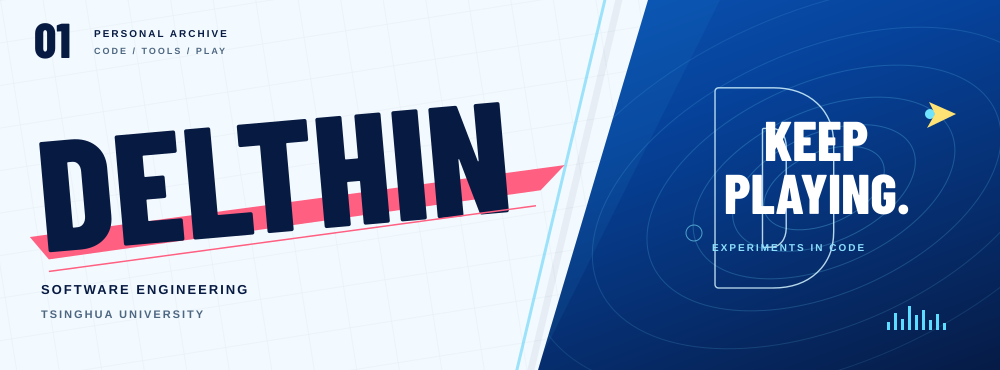

<picture>
  <source media="(prefers-color-scheme: dark) and (max-width: 600px)" srcset="./assets/hero-dark-mobile.svg">
  <source media="(max-width: 600px)" srcset="./assets/hero-mobile.svg">
  <source media="(prefers-color-scheme: dark)" srcset="./assets/hero-dark.svg">
  
</picture>

# Hi, I'm Delthin.

清华大学软件工程硕士在读，本科毕业于南京大学软件学院。

**Research interests** · GUI Agent · Agent Harness

[最近项目 ↓](#recent-work) · [所有仓库 ↗](https://github.com/Delthin?tab=repositories)

## Recent work

<!-- RECENT-WORK:START -->
<table>
<tr>
<td width="50%" valign="top">
<h3><a href="https://github.com/Delthin/moon-repomix">moon-repomix ↗</a></h3>

MoonBit native port of Repomix&#39;s local repository context packaging

<code>MoonBit</code> · 最近推送：2026-10-22 UTC

</td>
<td width="50%" valign="top">
<h3><a href="https://github.com/Delthin/pi-issue">pi-issue ↗</a></h3>

<code>TypeScript</code> · 最近推送：2026-09-19 UTC

</td>
</tr>
<tr>
<td width="50%" valign="top">
<h3><a href="https://github.com/Delthin/minecrag">minecrag ↗</a></h3>

<code>Python</code> · 最近推送：2026-09-12 UTC

</td>
<td width="50%" valign="top">
<h3><a href="https://github.com/Delthin/thu-graduate-course-helper">thu-graduate-course-helper ↗</a></h3>

<code>JavaScript</code> · 最近推送：2026-09-07 UTC

</td>
</tr>
</table>
<!-- RECENT-WORK:END -->

## Outside the editor

Rap、篮球、独立游戏。

## One commit at a time

<picture>
  <source media="(prefers-color-scheme: dark)" srcset="https://raw.githubusercontent.com/Delthin/Delthin/output/github-contribution-grid-snake-dark.svg">
  
</picture>
